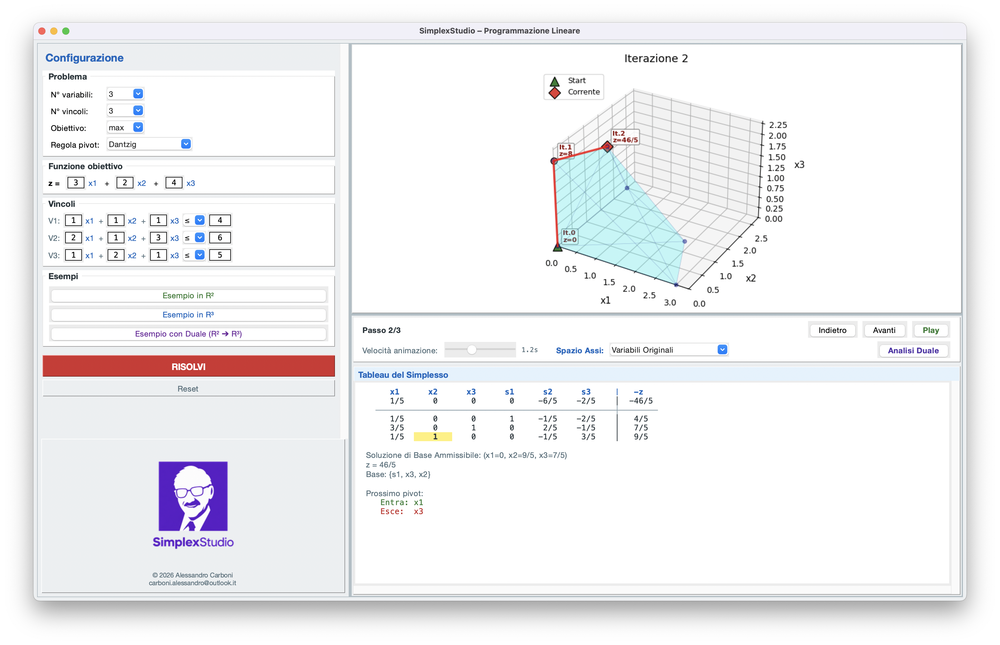
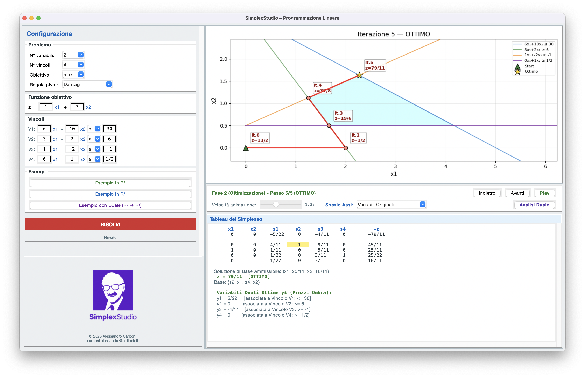

# SimplexStudio

Ambiente interattivo per lo studio e la risoluzione di problemi di **Programmazione Lineare** con il **Metodo del Simplesso**.

Interfaccia grafica con visualizzazione 2D/3D della regione ammissibile, animazione passo-passo del percorso del simplesso e tableau completo ad ogni iterazione.


<p align="center">
  
</p>

---

## Funzionalità

- **Metodo del Simplesso completo** con supporto a Due Fasi automatiche
- **Regole di Pivot flessibili**: regola classica di **Dantzig** (massimo costo ridotto, default) per la massima corrispondenza con la risoluzione manuale a lezione, affiancata dalla **Regola di Bland** (anti-ciclo) selezionabile per garantire la convergenza matematica in caso di degenerazione estrema
- **Qualsiasi tipo di vincolo**: `<=`, `>=`, `=`
- **Termini noti negativi** gestiti in automatico (normalizzazione con inversione di segno)
- **Interfaccia grafica** (Tkinter) con menu a tendina per configurare il problema
- **Visualizzazione 2D e 3D** della regione ammissibile con matplotlib
- **Doppia modalità di visualizzazione**: nello spazio delle **variabili originali** oppure nel sistema di riferimento delle **variabili fuori base (nuovi assi)** che si trasformano ad ogni cambio di base
- **Animazione** del percorso del simplesso vertice per vertice
- **Tableau interattivo** con evidenziazione del pivot e navigazione avanti/indietro
- **Teoria della Dualità completa**: finestra dedicata con formulazione automatica del problema duale associato, verifica del Teorema della Dualità Forte ($z^* = w^*$), Prezzi Ombra ($y^*$), verifica interattiva delle Condizioni di Scarto Complementare e rappresentazione geometrica 2D/3D del poliedro duale
- **Esempi precaricati**:
  - `Esempio in R³` (problema 3D canonico)
  - `Esempio in R²` (vincoli misti $\le, \ge$ con Due Fasi)
  - `Esempio con Duale (R² ➔ R³)` (2 variabili decisionali e 3 vincoli: regione primale poligonale 2D e poliedro duale solido 3D con traiettorie sincronizzate)

<p align="center">
  
</p>

---

## Installazione rapida

### 1. Installa Python

Se non hai Python installato:

| Sistema | Come installare |
|---------|----------------|
| **macOS** | Scarica da [python.org/downloads](https://www.python.org/downloads/) oppure `brew install python` |
| **Windows** | Scarica da [python.org/downloads](https://www.python.org/downloads/) — **spunta "Add Python to PATH"** durante l'installazione |
| **Linux** | `sudo apt install python3 python3-pip` (Ubuntu/Debian) |

Per verificare che Python sia installato, apri il terminale e scrivi:

```bash
python3 --version
```

> Su Windows potrebbe essere `python` invece di `python3`.

### 2. Scarica il progetto

**Opzione A** — Con Git:

```bash
git clone https://github.com/carbo99/simplex-studio.git
cd simplex-studio
```

**Opzione B** — Senza Git:

Clicca il pulsante verde **Code** > **Download ZIP** su GitHub, estrai la cartella e aprila nel terminale.

### 3. Installa le librerie

```bash
pip3 install numpy matplotlib scipy
```

> Su Windows usa `pip` invece di `pip3` se il primo non funziona.

### 4. Avvia SimplexStudio

```bash
python3 simplex_gui.py
```

---

## Come si usa

### Interfaccia grafica (`simplex_gui.py`)

1. **Configura il problema** nel pannello a sinistra:
   - Scegli il numero di variabili e vincoli dai menu a tendina
   - Seleziona `max` o `min` per l'obiettivo
   - Inserisci i coefficienti della funzione obiettivo
   - Inserisci i coefficienti di ogni vincolo, il segno (`<=`, `>=`, `=`) e il termine noto
   - Puoi usare frazioni: scrivi `1/2` invece di `0.5`

2. **Premi RISOLVI**

3. **Esplora la soluzione:**
   - Il **grafico** mostra la regione ammissibile e il vertice corrente
   - Il **tableau** mostra i valori esatti ad ogni iterazione
   - Usa **Avanti / Indietro** per navigare passo-passo
   - Usa **Play** per l'animazione automatica
   - Regola la **velocita** con lo slider

4. **Esempi precaricati:**
   - `Esempio in R³` — problema con 3 variabili e vincoli `<=`
   - `Esempio in R²` — problema con 2 variabili e vincoli misti (`<=`, `>=`)

#### Scorciatoie da tastiera

| Tasto | Azione |
|-------|--------|
| `→` (freccia destra) | Passo avanti |
| `←` (freccia sinistra) | Passo indietro |
| `Spazio` | Play / Pausa |
| `Esc` | Stop animazione |

---

## Struttura del progetto

```
simplex-studio/
├── simplex_gui.py      # Applicazione interattiva con interfaccia grafica (GUI)
├── simplex.py          # Motore matematico di calcolo (SimplexSolver a Due Fasi)
├── docs/img/           # Screenshot e risorse visive per la documentazione
└── README.md           # Documentazione e panoramica del progetto
```

---

## Formato del Tableau

Il tableau segue la notazione standard dei corsi di Ricerca Operativa:

```
                x1       x2       x3       s1       s2       s3     │  -z
                 0        -5       -4        0        0       -1    │  -5
   ─────────────────────────────────────────────────────────────────┼───────
                 0       1/4      7/4        1        0      -1/4   │ 11/4
                 0       3/4     -11/4       0        1      -3/4   │ 21/4
                 1       7/4      5/4        0        0       1/4   │  5/4
```

- **Intestazione**: nomi delle variabili (decisionali + slack/surplus)
- **Riga obiettivo**: sopra la linea di separazione
- **Righe vincoli**: sotto la linea di separazione
- **Colonna `-z`**: a destra, separata dal simbolo `│`

---

## Esempi inclusi

### Esempio in R³

```
max z = 3x₁ + 2x₂ + 4x₃
s.t.
    x₁ +  x₂ +  x₃ ≤ 4
   2x₁ +  x₂ + 3x₃ ≤ 6
    x₁ + 2x₂ +  x₃ ≤ 5
    x₁, x₂, x₃ ≥ 0
```

### Esempio in R²

```
max z = x₁ + 3x₂
s.t.
   6x₁ + 10x₂ ≤ 30
   3x₁ +  2x₂ ≥ 6
    x₁ -  2x₂ ≥ -1
           x₂ ≥ 1/2
    x₁, x₂ ≥ 0
```

---

## Requisiti

- **Python** 3.9 o superiore
- **numpy** — calcolo matriciale
- **matplotlib** — grafici 2D/3D
- **scipy** — calcolo dell'involucro convesso per la visualizzazione (opzionale ma consigliato)
- **tkinter** — interfaccia grafica (incluso in Python su macOS e Windows; su Linux: `sudo apt install python3-tk`)

---

## Generare un eseguibile

Per creare un file `.app` (macOS) o `.exe` (Windows) che non richiede Python installato:

```bash
pip3 install pyinstaller
pyinstaller --onefile --windowed --name "SimplexStudio" simplex_gui.py
```

L'eseguibile sara nella cartella `dist/`.

> L'eseguibile funziona solo sul sistema operativo su cui viene compilato.

---

## Licenza

Questo progetto e distribuito con licenza MIT.

---

**Copyright (c) 2026 Alessandro Carboni**
carboni.alessandro@outlook.it
